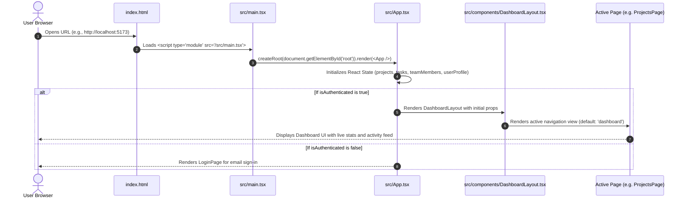
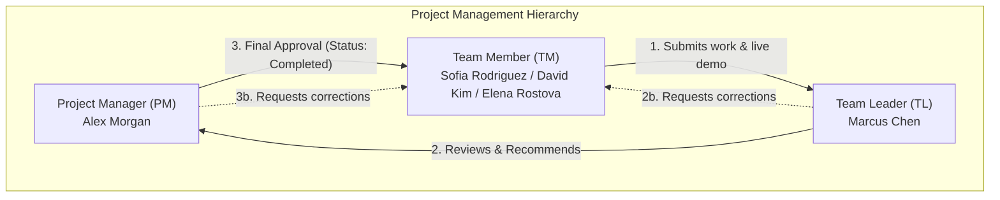
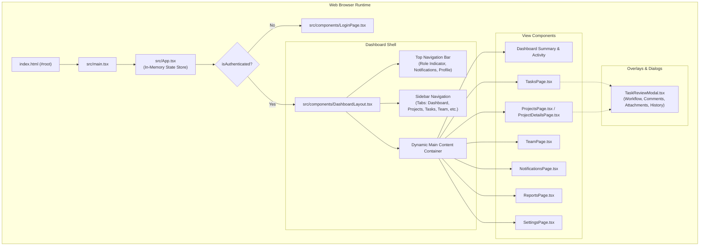

# Document 1: PMS Frontend Overview

## 1. What is the PMS Frontend?

The **Project Management System (PMS) Frontend** is the user-facing web application of a multi-role project management and delivery platform. It runs directly inside a user's web browser (such as Google Chrome, Mozilla Firefox, Microsoft Edge, or Apple Safari) and provides an interactive graphical user interface (GUI).

In this project, users can:
- View and create projects with deadlines, priorities, and assigned managers.
- Manage tasks across different stages (*Not Started*, *In Progress*, *Under Review*, *Completed*).
- Inspect team rosters and assign tasks to specific teammates.
- Submit completed task deliverables, including live demo links, screenshots, and documents.
- Perform a multi-stage review workflow where Team Leaders review work and only Project Managers can grant final completion approval.
- Switch between dark and light themes, inspect notification badges, and customize notification preferences.

---

## 2. What Does a Frontend Do?

A frontend is the software layer that people interact with directly. Its primary responsibilities include:

1. **User Interface (UI) Presentation**: Rendering buttons, cards, navigation sidebars, modal windows, forms, and progress bars using HTML elements styled with CSS and Tailwind CSS classes.
2. **User Interaction Handling**: Listening to events such as mouse clicks, keyboard inputs, form submissions, and modal closures, and updating what is visible on the screen.
3. **Client-Side State Management**: Keeping track of active session data (e.g., currently logged-in user, active page, list of projects, filter selections) in browser memory while the page is running.
4. **Input Validation and Guardrails**: Ensuring data entered by the user meets basic criteria (e.g., required fields, valid demo URL protocol like `https://`, file size boundaries) before processing.
5. **Role-Based UI Customization**: Adjusting visible action buttons and controls based on the active user role (Project Manager, Team Leader, or Team Member).

---

## 3. How the PMS Frontend Works: Startup to User Interaction

Here is the sequence of events that takes place when someone opens the project:

### Step-by-Step Execution:
1. **HTML Retrieval**: The browser requests `index.html`. It finds an empty container `

` and a script tag pointing to `src/main.tsx`.
2. **React Bootstrapping**: `src/main.tsx` loads React 19, imports `src/index.css` (Tailwind styles), finds the `root` DOM element, and mounts the `<App />` component inside `<StrictMode>`.
3. **State Initialization**: `src/App.tsx` initializes in-memory React state hooks (`useState`) holding the initial lists of projects, tasks, team members, and the active session profile.
4. **Conditional Screen Display**:
   - If `isAuthenticated` is `true`, it displays `DashboardLayout.tsx`.
   - If `isAuthenticated` is `false`, it displays `LoginPage.tsx`.
5. **User Interaction**: When a user clicks a navigation item (e.g., "Tasks" or "Settings"), React updates the state variable `activeItem`, triggering a re-render of only the content area without refreshing the web page.

---

## 4. Frontend vs. Backend vs. Database

Understanding the separation of concerns in modern web applications is vital for every developer:

| Layer | Where it Runs | Primary Purpose | Current Status in this Project |
| :--- | :--- | :--- | :--- |
| **Frontend** *(Client)* | User's web browser | Renders the visual interface, handles user clicks, provides responsive styling, and captures form data. | **Fully Implemented**: Complete UI with mock in-memory data, reactive filters, review modals, and theme switching. |
| **Backend** *(Server)* | Remote server (e.g., Node.js / Express, Python / FastAPI, Go) | Listens for HTTP requests (REST API / GraphQL), validates permissions, executes business rules, hashes passwords, and sends data back. | **Simulated**: Simulated in React client state. No external server currently exists. |
| **Database** *(Storage)* | Database engine (e.g., PostgreSQL, SQLite, MongoDB) | Stores user records, project records, tasks, files, and logs permanently on disk. | **Not Yet Connected**: Data currently resets to default sample constants when the browser tab is refreshed. |

---

## 5. The Three PMS Roles and Responsibilities

The application enforces a governance model based on three distinct workplace roles:

### 1. Project Manager (PM)
- **Role Identifier**: `'Project Manager'` (Default User: *Alex Morgan*)
- **Responsibilities**:
  - Creates and oversees all workspace projects.
  - Monitors high-level delivery schedules, progress percentages, and overdue tasks.
  - **Exclusive Authority**: The Project Manager is the **only** role permitted to grant **Final Approval** on a task to transition its status to `Completed`.
  - Can request corrections if deliverables do not satisfy project requirements.

### 2. Team Leader (TL)
- **Role Identifier**: `'Team Leader'` (Default User: *Marcus Chen*)
- **Responsibilities**:
  - Reviews initial submissions and demo deliverables uploaded by Team Members.
  - Evaluates code quality, design specifications, and test results.
  - Can choose either:
    - **Recommend Approval**: Forwards the task to the Project Manager for final sign-off (`tlRecommendation = 'recommended'`).
    - **Request Corrections**: Sends the task back to `In Progress` (`tlRecommendation = 'corrections_requested'`) with review feedback.
  - **Important Rule**: A Team Leader *cannot* mark a task as `Completed`.

### 3. Team Member (TM)
- **Role Identifier**: `'Team Member'` (Sample Users: *Sofia Rodriguez*, *David Kim*, *Elena Rostova*)
- **Responsibilities**:
  - Executes daily assignments and updates status from `Not Started` to `In Progress`.
  - Attaches deliverables, files, screenshots, documentation, or video walkthroughs.
  - Submits formal live demo links via `TaskReviewModal` for review, transitioning status to `Under Review`.
  - Implements required changes when corrections are requested by a Team Leader or Project Manager.

---

## 6. Main Features and Purposes

1. **Dashboard Overview**: Summary metric cards (Total Projects, Total Tasks, In Progress, Completed, Under Review, Overdue), quick shortcuts, and a live Activity Feed derived from real task history.
2. **Projects Management (`ProjectsPage.tsx` & `ProjectDetailsPage.tsx`)**:
   - Card grid with project progress bars, deadlines, priority tags, and manager avatars.
   - Project details view displaying all tasks grouped under that specific project.
   - "New Project" creation modal.
3. **Tasks Management (`TasksPage.tsx`)**:
   - Task list with multiple filtering options (by status, priority, project, and assignee).
   - "Add Task" modal supporting project association, team member assignment, priority, and deadline selection.
4. **Team Directory (`TeamPage.tsx`)**:
   - Visual cards showing all team members, emails, departments, assigned task tallies, and role badges.
   - Modals for adding new team members, editing details, or removing a member.
5. **Task Review and Approval Workflow (`TaskReviewModal.tsx`)**:
   - Multi-tab modal (*Workflow*, *Comments*, *Attachments*, *History*).
   - Live demo submission with URL protocol verification (`http://` or `https://`).
   - Strict governance: Only Project Managers can issue the `final_approve` action.
6. **Notifications (`NotificationsPage.tsx`)**:
   - System alerts and review event feed.
   - Filter between all and unread notifications; mark single or all items as read.
7. **Reports & Analytics (`ReportsPage.tsx`)**:
   - Real-time productivity metrics, project completion percentages, task status distribution, and priority ratios.
8. **Settings & Preferences (`SettingsPage.tsx`)**:
   - User Profile management with safe synchronization across team rosters and task assignments.
   - Notification preferences (toggle email/in-app triggers).
   - Appearance settings (Light/Dark mode toggle, custom accent colors).

---

## 7. What is Implemented vs. Simulated vs. Incomplete

### Implemented (Working in the Browser)
- Complete reactive UI across all 8 views and layouts.
- Dynamic data binding: modifying a task in `TaskReviewModal` instantly updates `TasksPage`, `ProjectDetailsPage`, `ReportsPage`, and `DashboardLayout` stats.
- Strict role checking in the review modal UI: `final_approve` button is disabled or blocked for non-PM roles.
- In-memory profile synchronization: editing your user profile in Settings immediately synchronizes your member card and task assignments.
- Theme switching: full CSS class overrides for dark and light modes.
- Production build and TypeScript compilation pass with zero errors (`npx tsc --noEmit` and `npm run build`).

### Simulated (Client-Side In-Memory)
- **Data Persistence**: All changes are stored in React component memory (`useState`). When you refresh the browser page (F5), state resets back to `INITIAL_PROJECTS`, `INITIAL_TASKS`, and `INITIAL_TEAM_MEMBERS`.
- **Authentication**: `LoginPage.tsx` simulates sign-in by matching email addresses in client memory. No encrypted passwords or JSON Web Tokens (JWT) are sent to an authentication server.
- **File Uploads**: Files uploaded in `TaskReviewModal.tsx` create local blob URLs using `URL.createObjectURL(file)`. They exist only within the current browser session and are not stored in cloud storage (e.g., AWS S3).

### Incomplete / Future Backend Scope
- Persistent SQL/NoSQL database storage.
- Real email delivery for notifications.
- Server-side access control (preventing modified HTTP requests from bypassing client UI rules).
- Live multi-user WebSocket synchronization.

---

## 8. High-Level Frontend Architecture Diagram

