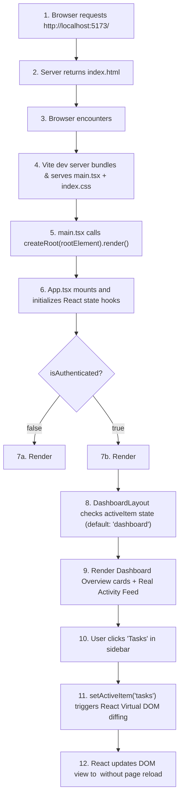

# Document 4: Application Startup and Rendering Execution Flow

This guide walks you through every micro-step of how the **PMS Frontend** boots up, mounts into the browser window, renders components, handles navigation, and compiles for production.

---

## 1. High-Level Lifecycle Flow Diagram



---

## 2. Step 1: The Initial HTML Document (`index.html`)

When a user navigates to the application URL, the browser first downloads `index.html`:

```html
<!doctype html>
<html lang="en">
  <head>
    <meta charset="UTF-8" />
    <link rel="icon" type="image/svg+xml" href="/favicon.svg" />
    <meta name="viewport" content="width=device-width, initial-scale=1.0" />
    <title>Project Management System (PMS) - Sign In</title>
  </head>
  <body>
    <div id="root"></div>
    <script type="module" src="/src/main.tsx"></script>
  </body>
</html>
```

### Key Elements:
1. `<div id="root"></div>`: An empty placeholder container. React will take control of everything inside this element.
2. `<script type="module" src="/src/main.tsx">`: Informs the browser that modern JavaScript module loading is in effect, pointing to the entry TypeScript file.

---

## 3. Step 2: The TypeScript Entry Point (`src/main.tsx`)

Vite reads and transforms `src/main.tsx`:

```tsx
import { StrictMode } from 'react'
import { createRoot } from 'react-dom/client'
import './index.css'
import App from './App.tsx'

createRoot(document.getElementById('root')!).render(
  <StrictMode>
    <App />
  </StrictMode>,
)
```

### What Happens Here:
1. `import './index.css'`: Injects Tailwind directives and global styling into the page's `<head>`.
2. `document.getElementById('root')!`: Finds the HTML `div`. The exclamation mark (`!`) is a TypeScript **non-null assertion operator**, telling the compiler that this element is guaranteed to exist.
3. `createRoot(...)`: Creates a React 19 Concurrent Root container.
4. `<StrictMode>`: A developer tool that checks for side effects, deprecated APIs, and unexpected state mutations during development.
5. `<App />`: The root component is evaluated and rendered.

---

## 4. Step 3: Root State Setup in `src/App.tsx`

`src/App.tsx` serves as the centralized **Single Source of Truth** for the workspace's in-memory data:

```tsx
export default function App() {
  // Session Authentication State (in-memory)
  const [isAuthenticated, setIsAuthenticated] = useState<boolean>(true);

  // Core Data State (in-memory, shared across sign-out and sign-in)
  const [projects, setProjects] = useState<Project[]>(INITIAL_PROJECTS);
  const [tasks, setTasks] = useState<Task[]>(INITIAL_TASKS);
  const [teamMembers, setTeamMembers] = useState<TeamMember[]>(INITIAL_TEAM_MEMBERS);

  // Settings: Profile, Notifications, Appearance
  const [userProfile, setUserProfile] = useState<UserProfile>({...});
  const [notificationPreferences, setNotificationPreferences] = useState<NotificationPreferences>({...});
  const [appearanceSettings, setAppearanceSettings] = useState<AppearanceSettings>({
    theme: 'dark',
    accentColor: 'purple',
    compactMode: false,
  });
```

### Conditional View Rendering:
```tsx
  if (!isAuthenticated) {
    return <LoginPage onLogin={handleLogin} />;
  }

  return (
    <DashboardLayout
      userEmail={userProfile.email}
      userName={userProfile.name}
      userRole={userProfile.role}
      userProfile={userProfile}
      onUpdateProfile={handleUpdateProfile}
      projects={projects}
      tasks={tasks}
      teamMembers={teamMembers}
      onLogout={handleLogout}
      onAddProject={handleAddProject}
      onAddTask={handleAddTask}
      onUpdateTask={handleUpdateTask}
      onAddMember={handleAddMember}
      onUpdateMember={handleUpdateMember}
      onRemoveMember={handleRemoveMember}
      // ...
    />
  );
```

If `isAuthenticated` is `false`, the user sees `LoginPage.tsx`. Once they click sign-in or a role card, `handleLogin` sets `isAuthenticated(true)` and the full workspace layout mounts immediately.

---

## 5. Step 4: The Navigation Mechanism in `DashboardLayout.tsx`

This project does **not** rely on external browser URL routers (like `react-router-dom`). Instead, it uses **State-Driven View Switching**:

```tsx
// Inside src/components/DashboardLayout.tsx
const [activeItem, setActiveItem] = useState('dashboard');
const [selectedProject, setSelectedProject] = useState<Project | null>(null);
```

When the user clicks a tab in the sidebar:
```tsx
<button
  onClick={() => {
    setActiveItem(item.id);
    setSelectedProject(null); // Clear selected project drilldown if navigating away
    setIsMobileMenuOpen(false); // Close mobile drawer
  }}
  className={`w-full flex items-center gap-3 px-3 py-2.5 rounded-xl font-medium ${
    activeItem === item.id
      ? 'bg-purple-600/20 text-purple-400 border border-purple-500/30'
      : 'text-slate-400 hover:text-white hover:bg-slate-800/40'
  }`}
>
  <item.icon className="w-5 h-5" />
  <span>{item.label}</span>
</button>
```

### The Switch Statement:
The layout evaluates `activeItem` to decide which component to render:

```tsx
const renderContent = () => {
  switch (activeItem) {
    case 'projects':
      if (selectedProject) {
        return (
          <ProjectDetailsPage
            project={selectedProject}
            tasks={tasks}
            teamMembers={teamMembers}
            currentUserRole={activeRole}
            onBack={() => setSelectedProject(null)}
            onAddTask={onAddTask}
            onUpdateTask={onUpdateTask}
          />
        );
      }
      return (
        <ProjectsPage
          projects={projects}
          onAddProject={onAddProject}
          onSelectProject={(project) => {
            setSelectedProject(project);
            setActiveItem('projects');
          }}
        />
      );

    case 'tasks':
      return <TasksPage tasks={tasks} projects={projects} ... />;

    case 'team':
      return <TeamPage members={teamMembers} tasks={tasks} ... />;

    case 'notifications':
      return <NotificationsPage notifications={computedNotifications} ... />;

    case 'reports':
      return <ReportsPage projects={projects} tasks={tasks} />;

    case 'settings':
      return <SettingsPage userProfile={userProfile} ... />;

    case 'dashboard':
    default:
      return <DashboardOverviewContent ... />;
  }
};
```

---

## 6. How Styling Is Applied (Tailwind & CSS Theme Engine)

1. **Compilation**: During development, PostCSS reads `src/index.css`.
2. **Class Generation**: Tailwind evaluates `@tailwind base; @tailwind components; @tailwind utilities;` and generates CSS rules only for the utility classes discovered in `src/**/*.tsx`.
3. **Theme Application**:
   - The root wrapper in `DashboardLayout.tsx` checks `appearanceSettings.theme`.
   - When set to `'light'`, it applies the CSS class `.theme-light` to the root container.
   - Rules in `src/index.css` target elements under `.theme-light` to override navy backgrounds (`#070b19`, `#0b112c`) with clean slate/white surfaces (`#ffffff`, `#f8fafc`) and dark text (`#0f172a`).

---

## 7. Development Server vs. Production Build

### In Development (`npm run dev`)
- Vite launches a local HTTP server at `http://localhost:5173`.
- Files are not pre-bundled into large chunks. When you modify a file (e.g., `TasksPage.tsx`), Vite uses **Hot Module Replacement (HMR)** to update only that specific component in the browser in less than 50 milliseconds without reloading the page or losing current state.

### In Production (`npm run build`)
1. **TypeScript Check**: Runs `tsc -b` (configured in `package.json`), checking every type, prop, and interface across the entire codebase. If there is a single type mismatch, the build halts immediately.
2. **Vite / Rollup Bundling**:
   - Compiles TypeScript to standard ES2020 JavaScript.
   - Minifies code and removes comments.
   - Bundles all CSS into a single compressed stylesheet (`dist/assets/index-[hash].css`).
   - Generates the final output inside the `dist/` directory, ready to be hosted on any static hosting platform (Vercel, Netlify, GitHub Pages, Nginx, or AWS S3).
