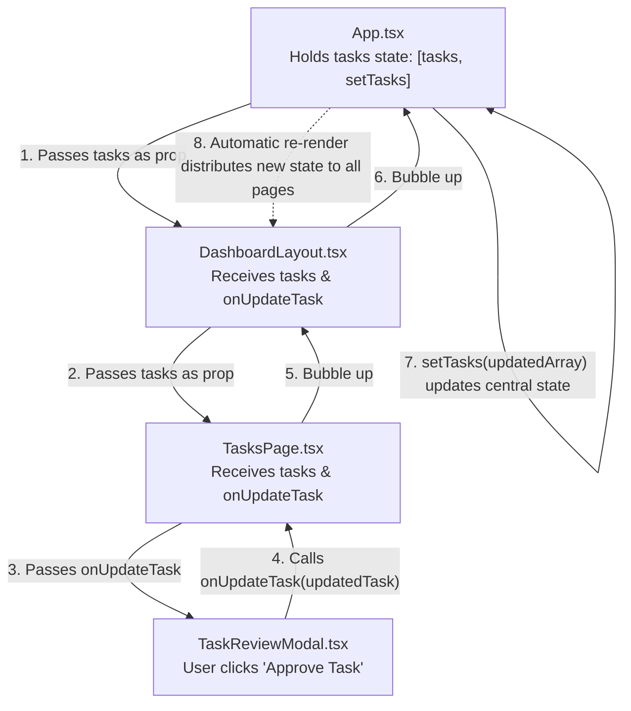

# Document 5: React and TypeScript Fundamentals (PMS Code Edition)

This guide is designed for beginners. It explains every core concept of React and TypeScript using real code snippets directly taken from the **PMS Frontend** workspace.

---

## 1. What is a Component?

In React, a **Component** is a JavaScript/TypeScript function that returns markup (HTML elements written in JSX/TSX syntax). Components allow you to split complex interfaces into self-contained, reusable pieces.

### Real Example from `src/components/LoginPage.tsx`:
```tsx
export default function LoginPage({ onLogin }: LoginPageProps) {
  const [email, setEmail] = useState('');
  const [password, setPassword] = useState('');

  return (
    <div className="min-h-screen bg-[#070b19] flex items-center justify-center p-4">
      {/* Login Card Form */}
    </div>
  );
}
```

### Line-by-Line Explanation:
- `export default function LoginPage(...)`: Declares and exports the component function so other files (like `App.tsx`) can import and use it.
- `return (...)`: The function returns the visual elements to be rendered in the browser.

---

## 2. What are Props (Properties)?

**Props** are arguments passed into a component from its parent, similar to passing arguments to a standard function. Props are **read-only** (immutable); a child component must never modify the props it receives directly.

### Real Example from `src/components/ProjectsPage.tsx`:
```tsx
interface ProjectsPageProps {
  projects: Project[];
  onAddProject?: (project: Project) => void;
  onSelectProject?: (project: Project) => void;
}

export default function ProjectsPage({
  projects,
  onAddProject,
  onSelectProject,
}: ProjectsPageProps) {
  // uses projects array to render project cards
}
```

### Line-by-Line Explanation:
- `interface ProjectsPageProps`: A TypeScript contract defining what data `ProjectsPage` expects from its parent (`DashboardLayout.tsx`).
- `projects: Project[]`: Expects an array of project objects.
- `onAddProject?: (...)`: An optional callback function passed down so the child can notify the parent when a new project is created.
- `({ projects, onAddProject }: ProjectsPageProps)`: Uses JavaScript **destructuring** to unpack the props directly into local variable names.

---

## 3. What is State (`useState`)?

While props pass data *into* a component, **State** is data that lives *inside* a component and can change over time based on user actions (typing in a box, clicking a tab, opening a modal).

When a state variable changes using its updater function, React automatically **re-renders** the component with the new data.

### Real Example from `src/components/DashboardLayout.tsx`:
```tsx
const [activeItem, setActiveItem] = useState('dashboard');
const [isMobileMenuOpen, setIsMobileMenuOpen] = useState(false);
```

### Line-by-Line Explanation:
- `const [activeItem, setActiveItem]`:
  - `activeItem`: The current value of the state (initially `'dashboard'`).
  - `setActiveItem`: The special setter function used to update the value.
- `useState('dashboard')`: The React hook initializing this piece of state.
- If you call `setActiveItem('tasks')`, React detects the change and updates the screen to show the Tasks page.

---

## 4. Derived State and Caching with `useMemo`

Sometimes you need to calculate values based on existing state (like counting overdue tasks). Instead of running heavy calculations on every render, `useMemo` calculates the result once and remembers (caches) it until its dependencies change.

### Real Example from `src/components/DashboardLayout.tsx`:
```tsx
const overdueTasksCount = useMemo(() => {
  return tasks.filter(
    (t) => t.deadline && t.status !== 'Completed' && new Date(t.deadline) < todayDate
  ).length;
}, [tasks, todayDate]);
```

### Line-by-Line Explanation:
- `tasks.filter(...)`: Filters the array for non-completed tasks whose deadline is earlier than today.
- `[tasks, todayDate]`: The **dependency array**. React will only recalculate `overdueTasksCount` when `tasks` or `todayDate` changes.

> **Note on `useEffect`**: While `useEffect` is a standard React hook for handling asynchronous side effects (such as fetching data from a remote server API), this frontend currently manages synchronous in-memory state. When a real backend API is connected, `useEffect` will be introduced to fetch projects and tasks upon initial page load.

---

## 5. Event Handlers

An **Event Handler** is a function that runs in response to user actions like clicking a button (`onClick`), typing in a field (`onChange`), or submitting a form (`onSubmit`).

### Real Example from `src/components/TaskReviewModal.tsx`:
```tsx
const handleAddComment = (e: React.FormEvent) => {
  e.preventDefault(); // Prevents the browser from reloading the page
  const content = newCommentInput.trim();
  if (!content) return; // Ignore empty comments

  const newComment: TaskComment = {
    id: `comment-${Date.now()}`,
    authorName: currentUserName,
    authorRole: currentUserRole,
    content,
    timestamp: new Date().toLocaleString(),
  };

  onUpdateTask({
    ...task,
    comments: [...(task.comments || []), newComment],
  });

  setNewCommentInput(''); // Clears input box after submission
};
```

---

## 6. Conditional Rendering

Conditional rendering displays different UI elements based on specific conditions (using ternary operators `? :` or logical AND `&&`).

### Real Example from `src/components/TaskReviewModal.tsx`:
```tsx
{/* Only Project Managers can see and click the Final Approval button */}
{isProjectManager && task.status !== 'Completed' && (
  <button
    onClick={() => handleWorkflowAction('final_approve')}
    className="flex items-center gap-2 bg-emerald-600 hover:bg-emerald-500 text-white px-4 py-2 rounded-lg font-medium shadow-lg"
  >
    <CheckCircle2 className="w-4 h-4" />
    <span>Grant Final Approval</span>
  </button>
)}
```

### Explanation:
If `isProjectManager` is `false` (e.g., current user is a Team Member), JavaScript short-circuits at the first check, and React renders nothing. The button physically does not appear in the DOM.

---

## 7. Lists and the `key` Prop

When rendering a list of items using `.map()`, React requires each item to have a unique `key` prop. This allows React's Virtual DOM to efficiently track which items were added, changed, or deleted.

### Real Example from `src/components/TeamPage.tsx`:
```tsx
<div className="grid grid-cols-1 md:grid-cols-2 lg:grid-cols-3 gap-6">
  {members.map((member) => (
    <div
      key={member.id}
      className="bg-[#0b112c] border border-slate-800 rounded-2xl p-5"
    >
      <h3 className="font-semibold text-white">{member.name}</h3>
      <p className="text-xs text-slate-400">{member.role}</p>
    </div>
  ))}
</div>
```

### Explanation:
`key={member.id}` uses the unique identifier (e.g., `'tm-1'`, `'tm-2'`) so React never mixes up cards when a team member is edited or removed.

---

## 8. TypeScript Interfaces and Type Safety

TypeScript interfaces define the shape of objects. If you omit a required property or assign the wrong type (e.g., assigning a number to a string), TypeScript warns you immediately before running the code.

### Real Example from `src/types/pms.ts`:
```typescript
export interface Project {
  id: string;
  name: string;
  description: string;
  manager: {
    name: string;
    role: string;
    avatarInitials: string;
  };
  startDate: string;
  deadline: string;
  status: 'In Progress' | 'Completed' | 'Planning' | 'On Hold';
  progress: number;
  priority: 'High' | 'Medium' | 'Low';
  tasksCount: {
    completed: number;
    total: number;
  };
}
```

### Union Types:
Notice:
```typescript
status: 'In Progress' | 'Completed' | 'Planning' | 'On Hold';
```
This is a **String Literal Union Type**. If someone writes `status: 'Done'`, TypeScript flags it as an error:
`Type '"Done"' is not assignable to type '"In Progress" | "Completed" | "Planning" | "On Hold"'`.

---

## 9. Parent-Child Communication (Lifting State Up)

In React, data flows **down** via props, and events flow **up** via callbacks. This pattern is called **Lifting State Up**.



### Why this is powerful:
When `TaskReviewModal` updates a task to `Completed`, `App.tsx` updates its central state array. Immediately and automatically:
- `TasksPage` shows the updated status badge.
- `ProjectDetailsPage` increments its completed task tally.
- `ReportsPage` recalculates project completion percentages.
- `DashboardLayout` increments the `Completed Tasks` counter.
All pages stay perfectly synchronized without manual page reloads.
