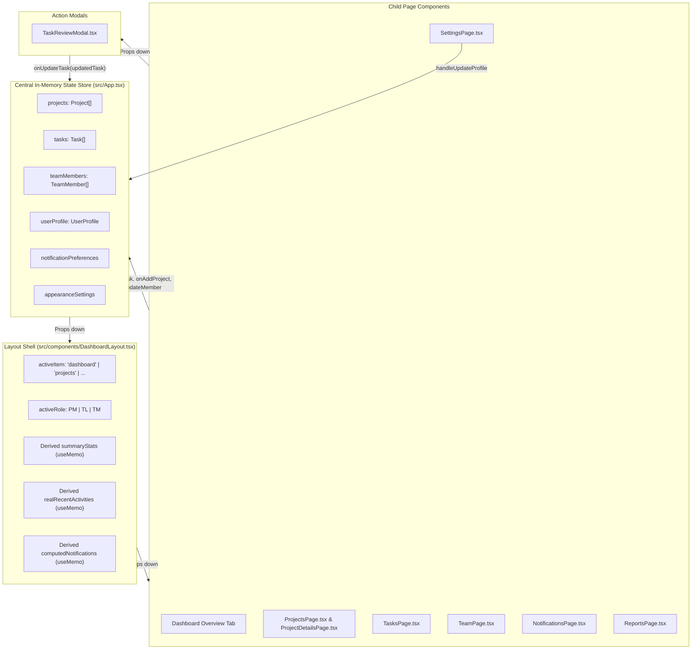

# Document 7: State Management and Data Flow Architecture

This document explains where data lives in the **PMS Frontend**, how components read and modify data, how changes ripple across pages, and the critical distinction between in-memory state and persistent database storage.

---

## 1. High-Level Data Flow Diagram



---

## 2. Where Data is Stored in the Current Application

In the current frontend codebase, data is stored in **React In-Memory State** using the `useState` hook inside `src/App.tsx`.

| Data Entity | State Variable in `App.tsx` | Initial Source Data | Scope |
| :--- | :--- | :--- | :--- |
| **Projects** | `projects` | `INITIAL_PROJECTS` (constant array) | Shared across all views |
| **Tasks** | `tasks` | `INITIAL_TASKS` (constant array) | Shared across all views |
| **Team Members** | `teamMembers` | `INITIAL_TEAM_MEMBERS` (constant array) | Shared across all views |
| **Current User Profile** | `userProfile` | Default: Alex Morgan (Project Manager) | Shared; syncs with team roster |
| **Notification Settings** | `notificationPreferences` | All 4 notification channels enabled (`true`) | Shared with SettingsPage |
| **Appearance** | `appearanceSettings` | Theme: `dark`, Accent: `purple`, Compact: `false` | Shared; controls root DOM styles |
| **Active Navigation Tab** | `activeItem` | Default: `'dashboard'` (in `DashboardLayout.tsx`) | Local to DashboardLayout |
| **Active Modal State** | `activeTab`, `commentText`, etc. | Component local state in `TaskReviewModal.tsx` | Local to modal |

---

## 3. How Components Read and Update Data

### Reading Data (Props Down)
When `App.tsx` renders `DashboardLayout`, it passes down the arrays as props:
```tsx
// src/App.tsx
<DashboardLayout
  projects={projects}
  tasks={tasks}
  teamMembers={teamMembers}
  userProfile={userProfile}
  onAddTask={handleAddTask}
  onUpdateTask={handleUpdateTask}
  // ...
/>
```
`DashboardLayout` then forwards these arrays to whichever page component is currently active:
```tsx
// Inside DashboardLayout.tsx
case 'tasks':
  return (
    <TasksPage
      tasks={tasks}
      projects={projects}
      teamMembers={teamMembers}
      currentUserRole={activeRole}
      onAddTask={onAddTask}
      onUpdateTask={onUpdateTask}
    />
  );
```

### Updating Data (Callbacks Up)
React enforces **unidirectional data flow** (one-way data binding). Child components do not modify arrays directly; they invoke callback functions passed down from `App.tsx`.

#### Example 1: Updating a Task in `TaskReviewModal`
When a Project Manager approves a task:
1. `TaskReviewModal` creates a copy of the task with status `'Completed'` and appends a review entry.
2. It calls `onUpdateTask(updatedTask)`.
3. The event bubbles up through `TasksPage` or `ProjectDetailsPage` to `DashboardLayout`, and finally to `App.tsx`:
   ```typescript
   // src/App.tsx
   const handleUpdateTask = (updatedTask: Task) => {
     setTasks((prev) =>
       prev.map((t) => (t.id === updatedTask.id ? updatedTask : t))
     );
   };
   ```
4. Calling `setTasks(...)` triggers a re-render of `App.tsx`.
5. The new `tasks` array flows down to `DashboardLayout`.
6. `summaryStats` recalculates completed tasks and in-progress counts.
7. `ReportsPage` recalculates project completion percentages.

#### Example 2: Adding a New Project
```typescript
// src/App.tsx
const handleAddProject = (newProject: Project) => {
  setProjects((prev) => [newProject, ...prev]);
};
```
This prepends `newProject` to the start of the `projects` array, making it immediately visible in `ProjectsPage` and in the project selector dropdowns of `TasksPage`.

---

## 4. Multi-Page Synchronization: Profile Editing

One of the most sophisticated examples of data flow in this codebase is the **Profile Synchronization** mechanism in `src/App.tsx`:

When you open **Settings** and update your name or email:
1. `handleUpdateProfile` receives the updated `UserProfile`.
2. It locks the role to prevent unauthorized privilege escalation:
   ```typescript
   const safeUpdatedProfile: UserProfile = {
     name: updated.name.trim(),
     email: updated.email.trim(),
     role: userProfile.role, // Governance lock
     department: updated.department.trim(),
   };
   ```
3. It updates `userProfile` state.
4. It iterates over `teamMembers` and updates the matching record (name, email, department, and newly calculated avatar initials).
5. It iterates over `tasks` and updates `task.assignedTo` for any task previously assigned to this user.
6. It iterates over `projects` and updates `project.manager.name` for any project managed by this user.

Result: Changing your name in Settings immediately reflects across the Team page, all task assignee tags, and project cards.

---

## 5. In-Memory State vs. Persistent Database Data

It is critical for a developer to understand what happens to this data when the application runs:

| Scenario | What Happens to Data? | Why? |
| :--- | :--- | :--- |
| **Navigating between tabs** (e.g. Dashboard → Tasks → Settings → Dashboard) | **Data Persists** | `App.tsx` remains mounted in memory. State in `useState` is preserved. |
| **Signing out to LoginPage and signing back in** | **Data Persists** | `App.tsx` only toggles `isAuthenticated` between `true` and `false`. The arrays in `useState` are not cleared. |
| **Refreshing the browser tab (F5 / Ctrl+R)** | **Data RESETS to initial sample data** | Refreshing the page wipes the browser's JavaScript memory and re-executes `main.tsx` from scratch. |
| **Closing and reopening the browser** | **Data RESETS to initial sample data** | In-memory state does not write to the computer's hard drive or a remote database. |

### Summary of What the Current Application Does NOT Do:
- Does **not** send HTTP POST/PUT/DELETE requests over the internet.
- Does **not** write to `localStorage` or `sessionStorage` (by design, keeping state cleanly encapsulated in React).
- Does **not** write to a SQLite, PostgreSQL, or MongoDB database.

To make data persist permanently across browser reloads, a real backend API and database must be connected (detailed in Document 12).
