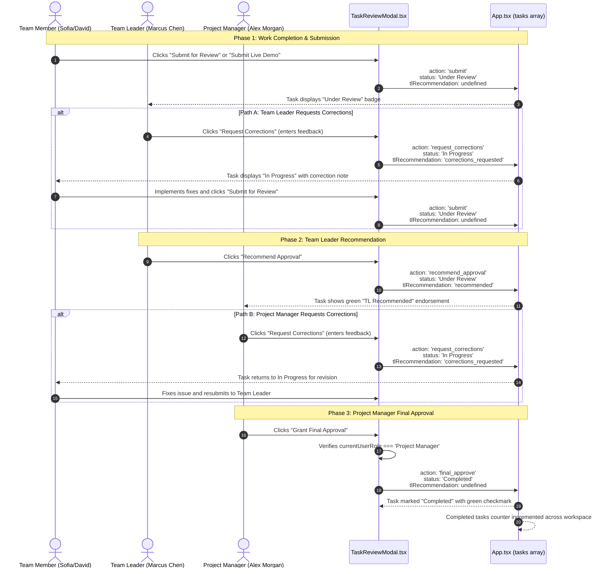

# Document 8: Task Review and Final Approval Governance Workflow

This document explains the end-to-end task review, correction loop, recommendation, and final approval workflow enforced within the **PMS Frontend**.

---

## 1. Governance Rules Overview

The application implements a strict four-stage hierarchy to govern task completion:

1. **Submission**: Team Members execute the task and submit deliverables (such as live demo URLs, screenshots, and test notes).
2. **First-Level Review (Team Leader)**: Team Leaders evaluate submissions. They can either:
   - **Request Corrections**: Sets task status back to `In Progress` with feedback.
   - **Recommend Approval**: Endorses the work for the Project Manager (`tlRecommendation = 'recommended'`).
3. **Resubmission Loop**: When corrections are requested, the Team Member revises the work and resubmits it, resetting recommendations and returning the task to `Under Review`.
4. **Final Approval Authority (Project Manager)**:
   - **Only the Project Manager** can grant final approval.
   - A task enters the `Completed` state **only** after successful Project Manager approval.
   - If a Project Manager requests corrections, the task returns to `In Progress`, requiring the Team Member to fix the issue and the Team Leader to re-review.
5. **Notification and Audit Log**: Every action appends an immutable entry to `task.reviewHistory`, capturing the actor's role, name, action type, comments, and timestamp.

---

## 2. Mermaid Sequence Diagram: The Complete Workflow



---

## 3. How the Code Enforces These Rules

### Rule 1: Who Can Perform What Actions
In `src/components/TaskReviewModal.tsx`:
```typescript
// Lines 107-114
const isTeamMember = currentUserRole === 'Team Member';
const isTeamLeader = currentUserRole === 'Team Leader';
const isProjectManager = currentUserRole === 'Project Manager';

const canSubmitForReview = isTeamMember && task.status !== 'Completed' && task.status !== 'Under Review';
const canTeamLeaderReview = isTeamLeader && task.status === 'Under Review';
const canProjectManagerReview = isProjectManager && task.status !== 'Completed';
```

### Rule 2: Only Project Manager Can Grant Final Approval
```typescript
// Lines 377-386 in TaskReviewModal.tsx
} else if (actionType === 'final_approve') {
  if (!isProjectManager) {
    setActionNotice('Permission Denied: Only Project Managers can grant final approval and complete tasks.');
    return;
  }
  // Project Manager Grants Final Approval -> Completed
  updatedStatus = 'Completed';
  updatedRecommendation = undefined;
  updatedFeedback = commentText.trim()
    ? `[Officially Approved by PM (${currentUserName})]: ${commentText.trim()}`
    : `Officially approved and completed by Project Manager (${currentUserName}).`;
}
```

If a Team Member or Team Leader attempts to trigger `final_approve`, the guard clause halts execution immediately and displays an access error notice.

### Rule 3: Team Leader Can Recommend or Request Corrections
```typescript
// Lines 363-376 in TaskReviewModal.tsx
} else if (actionType === 'request_corrections') {
  // Returned for revision -> back to In Progress
  updatedStatus = 'In Progress';
  updatedRecommendation = 'corrections_requested';
  updatedFeedback = commentText.trim()
    ? `[Corrections requested by ${currentUserRole} (${currentUserName})]: ${commentText.trim()}`
    : `Corrections requested by ${currentUserRole}. Revision required.`;
} else if (actionType === 'recommend_approval') {
  // Recommended by TL, remains Under Review waiting for PM final approval
  updatedStatus = 'Under Review';
  updatedRecommendation = 'recommended';
  updatedFeedback = commentText.trim()
    ? `[TL Recommendation (${currentUserName})]: Recommended for PM approval. ${commentText.trim()}`
    : `Recommended for approval by Team Leader (${currentUserName}). Awaiting PM approval.`;
}
```

### Rule 4: Submission and Resubmission Resets Recommendations
When a Team Member submits or resubmits work:
```typescript
if (actionType === 'submit') {
  updatedStatus = 'Under Review';
  updatedFeedback = commentText.trim()
    ? `[Submitted by ${currentUserName}]: ${commentText.trim()}`
    : `Task submitted for review by ${currentUserName}`;
  updatedRecommendation = undefined; // Clears any previous correction flags
}
```

---

## 4. The Complete Audit Trail (`reviewHistory`)

Every task maintains an array of `TaskReviewEntry` objects:

```typescript
export interface TaskReviewEntry {
  id: string;
  authorRole: 'Team Member' | 'Team Leader' | 'Project Manager';
  authorName: string;
  action: 'submit' | 'request_corrections' | 'recommend_approval' | 'final_approve';
  comment?: string;
  timestamp: string;
}
```

When you click the **History** tab in `TaskReviewModal`, this chronological timeline is rendered:
- **Green circle**: Final Approval by Project Manager.
- **Blue circle**: Approval Recommendation by Team Leader.
- **Amber circle**: Corrections Requested.
- **Purple circle**: Submitted for Review by Team Member.

---

## 5. Client-Side Enforcement vs. Server-Side Security

> [!WARNING]
> In this frontend, the rule "only Project Managers can approve" is enforced in React JavaScript code (`isProjectManager`).
>
> A client-side check is great for user experience because it prevents users from clicking buttons they shouldn't use. However, **client-side checks do not provide real security against malicious users**.
>
> Anyone with browser Developer Tools (F12) can modify JavaScript variables or send custom network requests.
>
> **When a real backend is implemented (Document 12)**:
> - The backend API route (`POST /api/tasks/:id/approve`) must inspect the user's cryptographically signed session token (JWT).
> - If the user's role in the database is not `PROJECT_MANAGER`, the server must reject the request with HTTP Status `403 Forbidden`.
