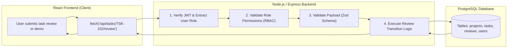

# Document 12: Frontend-to-Backend Integration and Architectural Roadmap

This document serves as the official engineering roadmap for transitioning the **PMS Frontend** from in-memory state to a production-ready, database-backed web platform.

> [!NOTE]
> This document is for **planning and architecture purposes only**. In accordance with Stage 5 requirements, no backend code or database schemas have been implemented yet.

---

## 1. Recommended Backend & Database Stack

After analyzing the existing frontend codebase (React 19, TypeScript, strict interfaces, and hierarchical relational data), the recommended backend stack is:

### **Stack Choice**: Node.js + TypeScript (Express / Fastify or NestJS) with PostgreSQL and Prisma ORM

### Why this stack fits best:
1. **Shared TypeScript Interfaces**: The exact models defined in `src/types/pms.ts` (`Project`, `Task`, `TaskReviewEntry`, etc.) can be directly shared between frontend and backend via a shared types package or monorepo workspace.
2. **Relational PostgreSQL Structure**: The PMS domain model is inherently relational:
   - A *Project* has many *Tasks*.
   - A *Task* has many *Comments*, *Attachments*, and *ReviewHistory* entries.
   - A *TeamMember* belongs to projects and is assigned to tasks.
   PostgreSQL enforces foreign-key constraints, cascading deletes, and ACID transaction guarantees.
3. **Prisma ORM**: Provides end-to-end type safety from the PostgreSQL database tables directly into your TypeScript API routes.

---

## 2. Core Backend Responsibilities

When connected, the backend will take over the following duties:



1. **Authentication & Session Tokens**:
   - Store hashed passwords (using `argon2` or `bcrypt`).
   - Issue secure, `HttpOnly`, `SameSite=Strict` JSON Web Tokens (JWT) or session cookies.
2. **Server-Side Role-Based Access Control (RBAC)**:
   - Enforce that **only** requests with a valid token where `role === 'Project Manager'` can execute the final approval endpoint.
   - Reject unauthorized requests with HTTP `403 Forbidden`.
3. **Permanent Database Storage**:
   - Persist projects, tasks, members, comments, and review logs to PostgreSQL tables.
4. **Cloud File Storage**:
   - Instead of browser blob URLs (`URL.createObjectURL`), generate Amazon S3 or Cloudflare R2 **presigned upload URLs**. The frontend uploads files directly to cloud storage, and only the secure URL is saved in the database.

---

## 3. Proposed RESTful API Endpoint Specification

| HTTP Method | Endpoint Path | Description | Required Role |
| :--- | :--- | :--- | :--- |
| `POST` | `/api/auth/login` | Validates email/password and returns session cookie. | Public |
| `POST` | `/api/auth/logout` | Clears authentication session cookie. | Authenticated |
| `GET` | `/api/auth/me` | Returns current user profile and role. | Authenticated |
| `GET` | `/api/projects` | Lists all projects with calculated progress. | Authenticated |
| `POST` | `/api/projects` | Creates a new project. | Project Manager |
| `GET` | `/api/projects/:id` | Returns project details with nested tasks. | Authenticated |
| `GET` | `/api/tasks` | Lists all tasks with filtering by project, status, assignee. | Authenticated |
| `POST` | `/api/tasks` | Creates a new task. | PM or Team Leader |
| `POST` | `/api/tasks/:id/submit` | Submits task or live demo for review. | Team Member |
| `POST` | `/api/tasks/:id/recommend` | Recommends task for PM approval. | Team Leader |
| `POST` | `/api/tasks/:id/corrections` | Requests corrections and returns task to In Progress. | PM or Team Leader |
| `POST` | `/api/tasks/:id/approve` | Grants final approval; marks task Completed. | **Project Manager Only** |
| `POST` | `/api/tasks/:id/comments` | Appends a comment to the task discussion. | Authenticated |
| `POST` | `/api/tasks/:id/attachments` | Generates presigned S3 upload URL. | Authenticated |
| `GET` | `/api/team` | Lists workspace team members. | Authenticated |
| `PUT` | `/api/team/:id` | Updates a team member's profile or department. | PM or Self |

---

## 4. Frontend Code Changes Required for Integration

### 1. Environment Variable Configuration
Create a `.env.local` file in the frontend root:
```env
VITE_API_BASE_URL=http://localhost:5000/api
```

### 2. API Service Layer
Create an API client module (e.g. `src/services/api.ts`) using standard `fetch`:
```typescript
const BASE_URL = import.meta.env.VITE_API_BASE_URL;

export async function fetchTasks(): Promise<Task[]> {
  const response = await fetch(`${BASE_URL}/tasks`, {
    credentials: 'include', // Sends HttpOnly session cookies
  });
  if (!response.ok) {
    throw new Error(`Failed to fetch tasks: ${response.statusText}`);
  }
  return response.json();
}
```

### 3. Adding Loading and Error States in React
Currently, components assume data is instantly available in memory. When connecting to an API, components must display **loading skeletons** and **error toasts**:

```tsx
export default function TasksPage() {
  const [tasks, setTasks] = useState<Task[]>([]);
  const [isLoading, setIsLoading] = useState<boolean>(true);
  const [errorMessage, setErrorMessage] = useState<string | null>(null);

  useEffect(() => {
    fetchTasks()
      .then((data) => {
        setTasks(data);
        setIsLoading(false);
      })
      .catch((err) => {
        setErrorMessage(err.message);
        setIsLoading(false);
      });
  }, []);

  if (isLoading) return <LoadingSpinner />;
  if (errorMessage) return <ErrorBanner message={errorMessage} />;
  // Render tasks...
}
```

---

## 5. Phased Integration Sequence

To avoid breaking the existing frontend, follow this step-by-step rollout:

1. **Phase 1: Backend Setup & Database Migration**
   - Initialize the Node.js / Express backend with Prisma.
   - Run database migrations to create PostgreSQL tables (`users`, `projects`, `tasks`, `reviews`, `comments`, `attachments`).
   - Seed the database with the existing sample data (`INITIAL_PROJECTS`, `INITIAL_TASKS`, `INITIAL_TEAM_MEMBERS`).
2. **Phase 2: Authentication & Session Verification**
   - Implement JWT login and replace the simulated `handleLogin` in `LoginPage.tsx` with real HTTP calls.
3. **Phase 3: Read Operations (GET Endpoints)**
   - Wire `GET /projects`, `GET /tasks`, and `GET /team` into `App.tsx` via `useEffect`.
   - Verify that data renders identically to the current mock state.
4. **Phase 4: Write Operations (POST & PUT Endpoints)**
   - Connect "Add Project", "Add Task", and "Add Member" modals to their respective `POST` endpoints.
5. **Phase 5: Review & Approval Workflow Integration**
   - Connect `TaskReviewModal` actions (`submit`, `request_corrections`, `recommend_approval`, `final_approve`) to backend endpoints.
   - Verify that server-side RBAC successfully blocks non-PM users from approving tasks.
6. **Phase 6: File Storage Migration**
   - Replace `URL.createObjectURL` with Amazon S3 / Cloudflare R2 presigned upload workflows.
