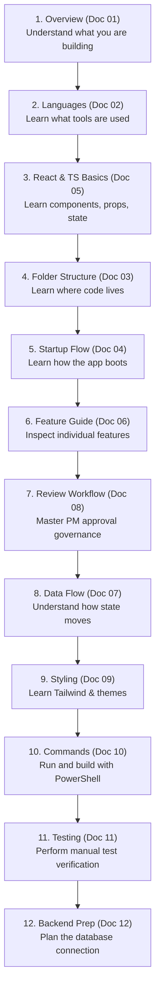

# PMS Frontend Technical and Learning Documentation

Welcome to the comprehensive technical documentation and learning guide for the **Project Management System (PMS) Frontend** (`C:\Users\j\Music\PMS frontend`).

This guide was written specifically for beginners, future maintainers, and engineers preparing to connect this frontend application to a production backend and database.

---

## 1. Documentation Index

The complete documentation suite is divided into 12 focused guides:

| Document | Title | Core Topics Covered |
| :---: | :--- | :--- |
| [01](01-Frontend-Overview.md) | **[Frontend Overview](01-Frontend-Overview.md)** | What the PMS is, frontend vs. backend vs. database, user roles (PM, TL, TM), features, and architecture. |
| [02](02-Languages-and-Technologies.md) | **[Languages and Technologies](02-Languages-and-Technologies.md)** | React 19, TypeScript, Tailwind CSS, Vite, Lucide icons, npm scripts, and libraries used. |
| [03](03-Project-Folder-Structure.md) | **[Project Folder Structure](03-Project-Folder-Structure.md)** | Complete folder tree, root configuration files, `src/` modules, and what happens if files break. |
| [04](04-Application-Startup-and-Rendering.md) | **[Startup and Rendering Flow](04-Application-Startup-and-Rendering.md)** | What `index.html` and `main.tsx` do, React mounting, state-driven navigation, and build bundling. |
| [05](05-React-and-TypeScript-Basics.md) | **[React and TypeScript Basics](05-React-and-TypeScript-Basics.md)** | Components, props, state (`useState`), `useMemo`, event handlers, conditional rendering, interfaces, and lifting state. |
| [06](06-Feature-by-Feature-Code-Guide.md) | **[Feature-by-Feature Code Guide](06-Feature-by-Feature-Code-Guide.md)** | Deep walkthrough of Dashboard, Projects, Tasks, Team, Review Modal, Notifications, Reports, and Settings. |
| [07](07-State-and-Data-Flow.md) | **[State and Data Flow](07-State-and-Data-Flow.md)** | In-memory React state, unidirectional data flow, multi-page profile synchronization, and persistence limits. |
| [08](08-Task-Review-and-Approval-Workflow.md) | **[Task Review and Approval Workflow](08-Task-Review-and-Approval-Workflow.md)** | Four-stage governance loop: member submission, TL review/recommendation, corrections, and PM final approval. |
| [09](09-Styling-and-Responsive-Design.md) | **[Styling and Responsive Design](09-Styling-and-Responsive-Design.md)** | Tailwind utility classes, responsive grid breakpoints (`sm:`, `md:`, `lg:`), and dual Dark/Light mode engine. |
| [10](10-Commands-and-Troubleshooting.md) | **[Commands and Troubleshooting Manual](10-Commands-and-Troubleshooting.md)** | Windows PowerShell guide: `npm run dev`, `npx tsc --noEmit`, `npm run build`, and solutions to common errors. |
| [11](11-Frontend-Testing-Guide.md) | **[Frontend Testing and QA Guide](11-Frontend-Testing-Guide.md)** | Automated build verification results, test matrix for all 8 views, validation checklists, and limitations. |
| [12](12-Frontend-to-Backend-Preparation.md) | **[Frontend-to-Backend Integration](12-Frontend-to-Backend-Preparation.md)** | Node.js + PostgreSQL stack recommendation, REST API endpoints, JWT authentication, and phased migration. |

---

## 2. Recommended Reading Order for Beginners

If you are new to web development, we recommend reading the documents in this order:

---

## 3. Current Frontend vs. Future Backend Capabilities

To keep expectations clear, here is what the current application provides versus what will be added in the backend phase:

| Capability | Current Frontend (Stage 5) | Future Backend + Database |
| :--- | :--- | :--- |
| **User Interface** | Fully interactive modern dashboard with dark/light mode. | Unchanged (frontend connects via API). |
| **Data Persistence** | **In-memory only**. Data resets on browser refresh. | **Permanent**. Stored safely in PostgreSQL database. |
| **Authentication** | Simulated role switching on `LoginPage.tsx`. | Real encrypted passwords and secure HTTP-only JWT cookies. |
| **Governance Security** | Enforced in React UI (`currentUserRole === 'Project Manager'`). | Enforced cryptographically on server (HTTP 403 Forbidden). |
| **File Attachments** | Temporary local browser memory blob URLs. | Permanent cloud storage (Amazon S3 / Cloudflare R2). |
| **Multi-User Sync** | Single-user browser tab. | Multi-user collaboration with live updates. |
